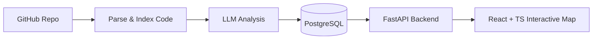
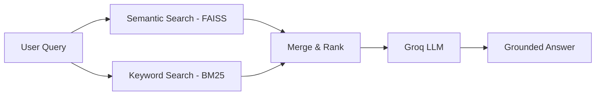
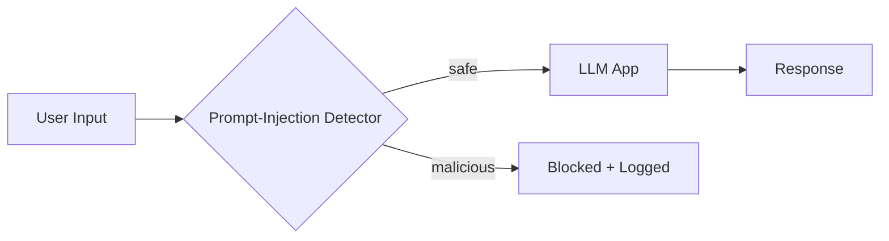

<!-- ============ ANIMATED HEADER ============ -->

  

  

  

---

## 🧭 About Me

I'm a **B.Tech Computer Science Engineering student** focused on AI and Machine Learning. I enjoy building AI-powered applications and practical software systems — from data processing and retrieval pipelines to APIs and user-facing products.

| | |
|---|---|
| 🔭 **Building** | [**CodeAtlas**](https://github.com/mulugumanishkumar2006-del/CodeAtlas), a platform that turns codebases into interactive architecture maps |
| 🌱 **Exploring** | LLM Applications · AI Agents · RAG · Backend Systems · ML Infrastructure · System Design |
| 💡 **Open to** | AI Engineer · ML Engineer · AI/ML Engineer · Software Engineer opportunities |
| ⚡ **Mindset** | Build → Engineer → Deploy → Improve |
| 💬 **Ask me about** | RAG pipelines · Prompt-injection defense · ETL & data preparation · FastAPI backends |

---

## 🎯 What I Do

- Build AI applications using LLMs, retrieval, and agent workflows.
- Develop backend services and REST APIs with Python and FastAPI.
- Work with structured data, SQL, preprocessing, and analytics.
- Explore practical approaches to making AI applications more reliable and secure.

---

## 💼 Experience

<table>
  <tr>
    <td width="170" align="center">
      
    </td>
    <td>
      <b>Data Analyst Intern</b> 
      Worked on SQL-based data workflows and preprocessing for financial datasets, helping transform raw data into analysis-ready information and reports.
        
      
      
      
      
    </td>
  </tr>
</table>

---

## 🎓 Education

**B.Tech – Computer Science Engineering**  
Sir Padampat Singhania University  
Specialization: Artificial Intelligence & Machine Learning

---

## 🛠 Tech Stack

  

<b>See stack by category</b>

| Category | Tools |
|---|---|
| **Languages** | Python · SQL · C++ · JavaScript · TypeScript |
| **AI / ML** | NumPy · Pandas · scikit-learn · TensorFlow · PyTorch · LangChain · FAISS · BM25 |
| **Backend & Infrastructure** | FastAPI · PostgreSQL · Docker · Git · Oracle Cloud (OCI) |
| **Frontend** | React · TypeScript |

---

## 🚀 Featured Projects

<table>
  <tr>
    <td width="50%" valign="top">
      <h3>🗺️ <a href="https://github.com/mulugumanishkumar2006-del/CodeAtlas">CodeAtlas</a></h3>
      A repository intelligence platform designed to turn codebases into interactive architecture maps and help developers understand unfamiliar projects.
        
      
      
      
      
      
    </td>
    <td width="50%" valign="top">
      <h3>🤖 <a href="https://github.com/mulugumanishkumar2006-del/groq-hybrid-rag">Hybrid RAG System</a></h3>
      A retrieval pipeline combining semantic search with FAISS and keyword search with BM25 for more relevant, context-grounded question answering.
        
      
      
      
      
      
    </td>
  </tr>
  <tr>
    <td width="50%" valign="top">
      <h3>🔒 <a href="https://github.com/mulugumanishkumar2006-del/secure-ai-firewall-system">Secure AI Firewall</a></h3>
      A security-focused layer for LLM applications that aims to detect prompt-injection attempts and protect AI application workflows.
        
      
      
      
    </td>
    <td width="50%" valign="top">
      <h3>📈 <a href="https://github.com/mulugumanishkumar2006-del/nifty100-financial-intelligence-platform">Financial Intelligence Platform</a></h3>
      An analytics project using data processing and SQL-oriented workflows to explore financial datasets and present useful insights.
        
      
      
      
      
      
    </td>
  </tr>
</table>

<b>🔍 How my flagship projects work (architecture)</b>

**CodeAtlas**

**Hybrid RAG System**

**Secure AI Firewall**

---

## 🏆 Certifications

---

## 🌱 Currently Leveling Up

- [x] Building hybrid retrieval workflows with semantic and keyword search
- [x] Exploring LLM security and prompt-injection defense
- [ ] Shipping CodeAtlas for real-world use
- [ ] Improving AI agents with tool use and evaluation
- [ ] Learning ML infrastructure and deployment practices
- [ ] Deepening system design: caching, queues, and observability

---

## 📊 GitHub Stats

  

  

---

## 🐍 Contribution Activity

---

## 🤝 Let's Build Something

I'm interested in **AI/ML Engineer, ML Engineer, and Software Engineer** opportunities, including internships. I'm also open to collaborating on practical LLM, RAG, and AI agent projects.

📧 **[mulugumanishkumar2006@gmail.com](mailto:mulugumanishkumar2006@gmail.com)** &nbsp;·&nbsp; 💼 **[LinkedIn](https://www.linkedin.com/in/mulugu-maneesh-kumar-b76962340)**

 

<i>Building AI applications, exploring new technologies, and shipping useful products.</i>

