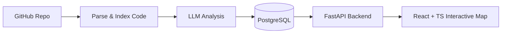
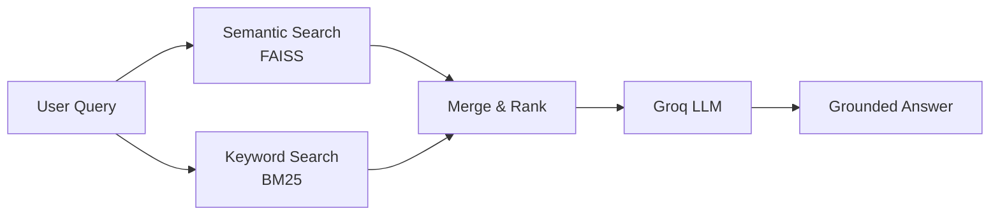
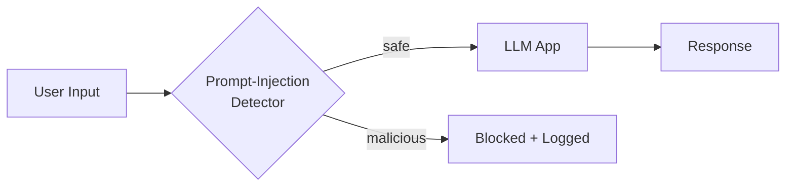

<!-- ============ HEADER ============ -->

  

  

<!-- TODO: uncomment and add your links

-->

  

 

<!-- ============ ABOUT ============ -->
## 🧭 About Me

I'm a pre-final year **B.Tech Computer Science (AI & ML)** student who builds **AI-powered products and production-ready software**. I don't stop at a notebook: I wrap models in APIs, add retrieval, security and data pipelines, and ship interfaces people can actually use.

| | |
|---|---|
| 🔭 **Building** | [**CodeAtlas**](https://github.com/mulugumanishkumar2006-del/CodeAtlas), an LLM-powered platform that turns codebases into interactive architecture maps |
| 🌱 **Exploring** | LLM Applications · AI Agents · RAG · Backend Systems · ML Infrastructure · System Design |
| 💡 **Open to** | AI Engineer · ML Engineer · AI/ML Engineer · Software Engineer |
| ⚡ **Mindset** | Build → Engineer → Deploy → Improve |
| 💬 **Ask me about** | RAG pipelines · prompt-injection defense · ETL & data prep · FastAPI backends |

 

<!-- ============ WHAT I DO ============ -->
## 🎯 What I Do

<table>
  <tr>
    <td width="25%" align="center" valign="top">
      <h3>🧠</h3>
      <b>LLM Applications</b> 
      RAG, agents and tool-using assistants grounded in real data
    </td>
    <td width="25%" align="center" valign="top">
      <h3>⚙️</h3>
      <b>Backend Engineering</b> 
      FastAPI services, PostgreSQL, Dockerized deployments
    </td>
    <td width="25%" align="center" valign="top">
      <h3>🔒</h3>
      <b>LLM Security</b> 
      Prompt-injection detection and guardrails for production apps
    </td>
    <td width="25%" align="center" valign="top">
      <h3>📊</h3>
      <b>Data Pipelines</b> 
      SQL ETL, preprocessing and analysis-ready reporting
    </td>
  </tr>
</table>

 

<!-- ============ EXPERIENCE + EDUCATION ============ -->
## 💼 Experience

<table>
  <tr>
    <td width="170" align="center">
      
    </td>
    <td>
      <b>Data Analyst Intern</b> 
      Built SQL-based ETL workflows and preprocessing pipelines for financial datasets, working with mentors to turn raw data into analysis-ready reports.
        
      
      
      
      
    </td>
  </tr>
</table>

## 🎓 Education

<table>
  <tr>
    <td width="170" align="center">
      
    </td>
    <td>
      <b>B.Tech, Computer Science (AI &amp; ML)</b> 
      Pre-final year<!-- TODO: add college name and expected graduation year, e.g. "· Your College · 2027" -->
    </td>
  </tr>
</table>

 

<!-- ============ TECH STACK ============ -->
## 🛠 Tech Stack

  

<b>See stack by category</b>

 

| Category | Tools |
|---|---|
| **Languages** | Python · SQL · C++ · JavaScript · TypeScript |
| **AI / ML** | NumPy · Pandas · scikit-learn · TensorFlow · PyTorch · LangChain · FAISS · BM25 |
| **Backend & Infra** | FastAPI · PostgreSQL · Docker · Git · Oracle Cloud (OCI) |
| **Frontend** | React · TypeScript |

 

<!-- ============ PROJECTS ============ -->
## 🚀 Featured Projects

<table>
  <tr>
    <td width="50%" valign="top">
      <h3>🗺️ <a href="https://github.com/mulugumanishkumar2006-del/CodeAtlas">CodeAtlas</a></h3>
      Converts repositories into interactive architecture maps using LLMs, so engineers can understand unfamiliar codebases in minutes instead of days.
        
      
      
      
      
      
      
    </td>
    <td width="50%" valign="top">
      <h3>🤖 <a href="https://github.com/mulugumanishkumar2006-del/groq-hybrid-rag">Hybrid RAG System</a></h3>
      Retrieval pipeline combining semantic (FAISS) and keyword (BM25) search to reduce hallucinations and improve answer relevance for AI-assisted Q&amp;A.
        
      
      
      
      
      
    </td>
  </tr>
  <tr>
    <td width="50%" valign="top">
      <h3>🔒 <a href="https://github.com/mulugumanishkumar2006-del/secure-ai-firewall-system">Secure AI Firewall</a></h3>
      Security layer for LLM applications that detects and blocks prompt-injection attacks in real time, designed as drop-in middleware for production apps.
        
      
      
      
    </td>
    <td width="50%" valign="top">
      <h3>📈 <a href="https://github.com/mulugumanishkumar2006-del/nifty100-financial-intelligence-platform">Financial Intelligence Platform</a></h3>
      End-to-end analytics platform with ETL pipelines, SQL integration, and dashboards for exploring and reporting on financial datasets.
        
      
      
      
      
      
    </td>
  </tr>
</table>

<b>🔍 How my flagship projects work (architecture)</b>

 

**CodeAtlas**

**Hybrid RAG System**

**Secure AI Firewall**

 

<!-- ============ CERTIFICATIONS ============ -->
## 🏆 Certifications

 

<!-- ============ ROADMAP ============ -->
## 🌱 Currently Leveling Up

- [x] Production RAG with hybrid retrieval
- [x] LLM security and prompt-injection defense
- [ ] Shipping CodeAtlas to real users
- [ ] AI agents with tool use and evaluation
- [ ] ML infrastructure and deployment at scale
- [ ] Deeper system design (caching, queues, observability)

 

<!-- ============ STATS ============ -->
## 📊 GitHub Stats

 

 

 

<!-- ============ CONTACT ============ -->
## 🤝 Let's Build Something

I'm looking for **AI/ML Engineer, ML Engineer and Software Engineer** opportunities (internships and full-time), and I'm always up for collaborating on LLM, RAG and agent projects. If you're hiring or have an idea, reach out.

📧 **[mulugumanishkumar2006@gmail.com](mailto:mulugumanishkumar2006@gmail.com)** &nbsp;·&nbsp; 💼 **[LinkedIn](https://www.linkedin.com/in/mulugu-maneesh-kumar-b76962340)**

 

<i>Building AI applications, exploring new tech, and shipping.</i>

